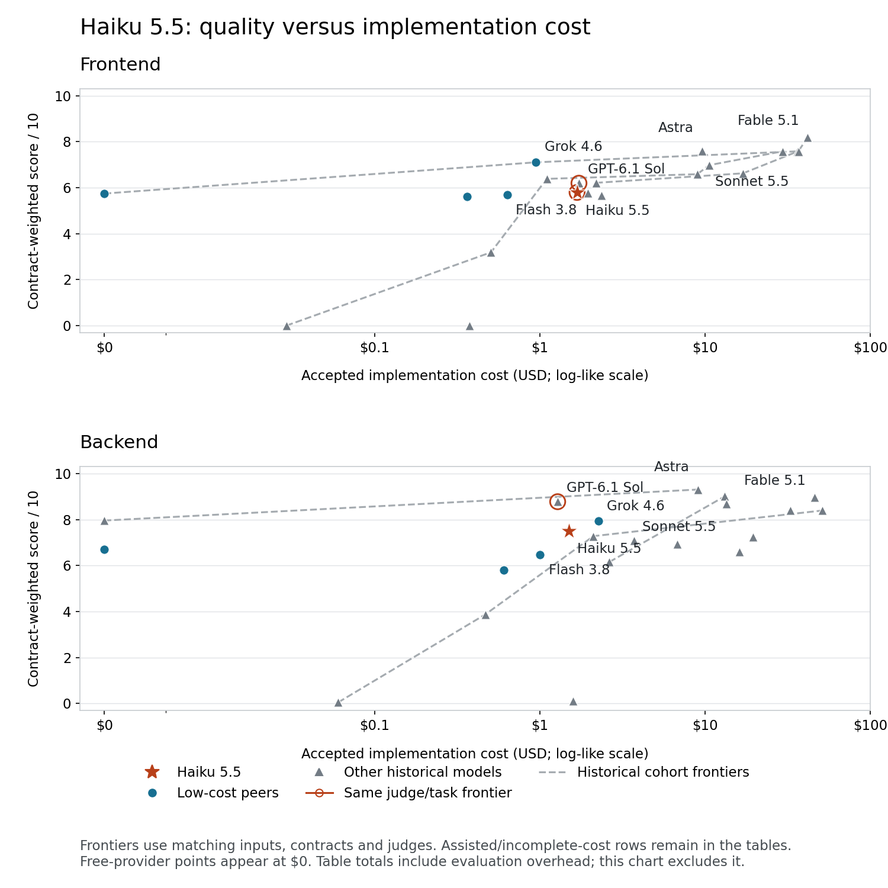

# Haiku 5.5 — Basecamp Bench, October 9, 2026

Claude Code, high effort; one independent attempt per track; GPT-6.1 Sol high evaluator.

Wall-clock elapsed time: 0:38:15. Summed implementation/evaluation stage time: 1:08:51.

Haiku scored 5.794 on frontend and 7.506 on backend for $4.89 including evaluation. It scored above both Flash generations on both tracks at a lower total cost. GPT-6.1 Sol scored higher on both tracks at almost the same total cost ($4.92). Accepted implementation cost was $3.18 for Haiku versus $3.01 for Sol; Haiku has a small frontend build-cost advantage, while Sol is cheaper and higher-scoring on backend.

The frontend has a coherent shared model and genuine mutations, but empty-list creation, calendar isolation, Jump destinations, storage recovery, and accessibility need work. The backend registered all 203 operations; 202 were HTTP-reachable. Restoration, failed-create atomicity, authorization boundaries, and populated timesheet responses drove deductions.

Evaluation evidence is limited by the sandbox: frontend rendered/browser acceptance and backend TCP lifecycle were blocked. FE tests used the actual script in a Node VM; BE tests used Node’s real HTTP parser with memory-backed connections. These limitations are recorded in the detailed evaluator reports.

## Haiku run details

| Track | Score | Build time | Eval time | Build cost | Eval cost | Total cost |
| --- | ---: | ---: | ---: | ---: | ---: | ---: |
| FE | 5.794 | 0:18:41 | 0:11:55 | $1.68 | $0.80 | $2.48 |
| BE | 7.506 | 0:18:39 | 0:19:36 | $1.50 | $0.91 | $2.40 |
| Total | — | 0:37:20 | 0:31:31 | $3.18 | $1.70 | $4.89 |

## Low-cost comparison

| Model | Frontend | Backend | Total time | Total cost |
| --- | ---: | ---: | ---: | ---: |
| Grok 4.6 | 7.104 | 7.926 | 0:57:58 | $10.85 |
| Grok 4.7 High* | 6.650 | 7.605 | 4:20:06 | ≥$10.46 |
| **Claude Haiku 5.5 High** | **5.794** | **7.506** | **1:08:51** | **$4.89** |
| Muse Spark 1.3 | 5.745 | 6.711 | 0:42:24 | $4.58 |
| Gemini 3.8 Flash High | 5.700 | 6.483 | 0:38:17 | $6.07 |
| GPT-6 Luna Max* | 5.434 | 6.695 | ~5:17:32 | ≥$3.30 |
| Gemini 3.7 Flash High | 5.608 | 5.800 | 0:30:59 | $7.54 |

## Overall comparison

| Model | Frontend | Backend | Total time | Total cost |
| --- | ---: | ---: | ---: | ---: |
| Claude Fable 5.1 | 8.183 | 8.965 | 3:04:06 | $92.96 |
| GPT-6 Astra | 7.607 | 9.305 | 1:36:31 | $25.57 |
| Claude Sonnet 5.5 (High) | 7.575 | 9.011 | 2:18:20 | $52.30 |
| Claude Opus 5 | 7.583 | 8.390 | 2:26:31 | $78.11 |
| Claude Fable 5 | 7.578 | 8.392 | 2:06:41 | $85.87 |
| Claude Opus 5.5 (High) | 6.625 | 8.683 | 1:59:02 | $32.30 |
| Grok 4.6 | 7.104 | 7.926 | 0:57:58 | $10.85 |
| GPT-6.1 Sol (High) | 6.195 | 8.775 | 1:52:05 | $4.92 |
| Grok 4.7 High* | 6.650 | 7.605 | 4:20:06 | ≥$10.46 |
| Claude Sonnet 5 | 6.982 | 7.243 | 1:27:09 | $36.23 |
| Grok 4.5 | 6.384 | 7.278 | 0:36:48 | $9.30 |
| **Claude Haiku 5.5 High** | **5.794** | **7.506** | **1:08:51** | **$4.89** |
| Claude Opus 4.8 | 6.587 | 6.590 | 1:31:21 | $29.83 |
| GPT-5.5 | 5.670 | 7.084 | 0:44:15 | $10.94 |
| GPT-5.6 Sol High (latest r5) | 5.780 | 6.930 | 0:51:21 | $13.94 |
| Muse Spark 1.3 | 5.745 | 6.711 | 0:42:24 | $4.58 |
| GPT-6 Sol High | 6.212 | 6.155 | 1:33:42 | $6.73 |
| Gemini 3.8 Flash High | 5.700 | 6.483 | 0:38:17 | $6.07 |
| GPT-6 Luna Max* | 5.434 | 6.695 | ~5:17:32 | ≥$3.30 |
| Gemini 3.7 Flash High | 5.608 | 5.800 | 0:30:59 | $7.54 |
| Gemini 3.1 Pro High | 3.190 | 3.872 | 0:22:07 | $4.57 |
| Gemini 3.5 Flash High | 0.000 | 0.100 | 0:12:47 | $3.48 |
| GLM 5.2 | 0.000 | 0.050 | 0:38:25 | $1.55 |
| 0x Alpha Max (unranked) | — | 7.956 | 1:03:17 | $3.56 |

Scores are contract-weighted and ordered by FE + BE score. Total time sums stage durations, including stages running concurrently; it is not wall-clock elapsed time. Total cost includes implementation and evaluation, excludes readiness smoke tests, and is calculated before rounding. Claude costs are reported list-price usage; other costs retain their saved accounting and pricing.

* Luna backend and Grok 4.7 frontend include Sol assistance. Their full-lineage costs are lower bounds; Luna time is approximate. 0x Alpha has no FE evaluation and remains unranked. Historical judges and FE contracts differ. Chart frontiers must remain within the same task inputs, contract, and judge; assisted or incomplete-cost points do not establish an autonomous frontier.

GPT-5.6 Sol uses the established latest complete r5 repetition (5.780 FE / 6.930 BE), preserving the September comparison policy. The README and earlier September JSON selected different repetitions.

## Dimension scores

### FE

| Dimension | Score |
| --- | ---: |
| accessibility | 4.500 |
| code architecture | 6.500 |
| functional depth | 6.200 |
| interaction quality | 5.000 |
| product model | 7.500 |
| reference fidelity | 5.000 |
| reliability | 5.500 |
| responsive adaptation | 4.500 |
| state persistence | 6.000 |
| surface coverage | 6.800 |
| visual craft | 6.000 |

### BE

| Dimension | Score |
| --- | ---: |
| architecture domain | 8.000 |
| behavioral depth | 6.200 |
| code quality | 8.000 |
| endpoint coverage | 9.800 |
| http contract | 7.000 |
| operability | 8.200 |
| request hardening | 5.800 |
| scope honesty | 7.000 |
| seed fidelity | 8.000 |

## Implementation token usage

| Track | Uncached input | Cached input | Cache writes | Output | Thinking within output |
| --- | ---: | ---: | ---: | ---: | ---: |
| FE | 138 | 18,277,776 | 337,959 | 249,979 | 128,407 |
| BE | 126 | 12,937,939 | 365,561 | 255,083 | 123,229 |

Token buckets are session aggregates. Thinking tokens are included within output and must not be added again. Haiku costs use the vendor-reported request-tier/cache-lifetime accounting.

## Evidence

- [Run manifest](../../runs/2026-10-09T06-34-57Z--fe-be--anthropic-claude-haiku-5-5--20261009t063457z-ac508c/run-manifest.json)
- [FE attempt](../../runs/2026-10-09T06-34-57Z--fe-be--anthropic-claude-haiku-5-5--20261009t063457z-ac508c/attempts/fe-claude-haiku-55-anthropic-claude-haiku-5-5-r1--619c55c8.json)
- [BE attempt](../../runs/2026-10-09T06-34-57Z--fe-be--anthropic-claude-haiku-5-5--20261009t063457z-ac508c/attempts/be-claude-haiku-55-anthropic-claude-haiku-5-5-r1--ede4674f.json)
- [Selected historical source paths and raw comparison data](comparison.json)
- [Detailed Haiku report](haiku-detail.html)

